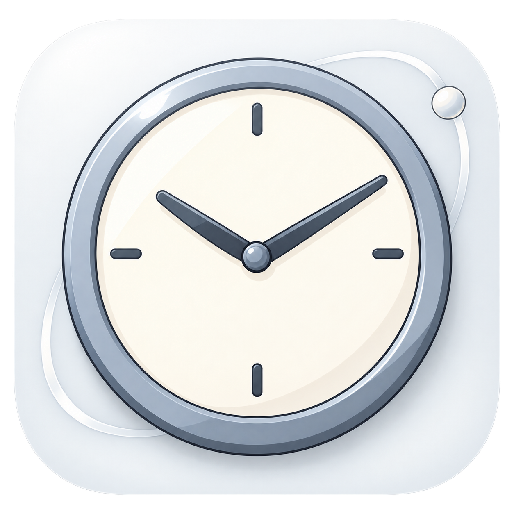

# Time

轻量 macOS 菜单栏世界时钟。默认显示上海时间，也可以切换到其他时区，让系统继续使用所在地时间。

## 下载与安装

支持 **macOS 13 及以上版本**，Universal 应用同时支持 **Apple Silicon 和 Intel Mac**。下载安装包即可使用，无需 Xcode。

- [下载 DMG](https://github.com/yauyy/time/releases/latest/download/Time-macOS-universal.dmg) · [下载 ZIP](https://github.com/yauyy/time/releases/latest/download/Time-macOS-universal.zip)
- [所有版本与更新说明](https://github.com/yauyy/time/releases) · [SHA256 校验文件](https://github.com/yauyy/time/releases/latest/download/SHA256SUMS.txt)

打开 DMG，把 **Time.app** 拖到“应用程序”；使用 ZIP 时，先解压再拖入。启动后，Time 常驻菜单栏，不显示 Dock 图标；点击菜单栏上的时间即可打开面板。

当前版本采用 ad hoc 签名，尚未经过 Apple 公证。首次打开若被 macOS 拦截，确认下载来源后，到“系统设置 → 隐私与安全性”点击“仍要打开”，再按提示确认。参见 [Apple 官方操作说明](https://support.apple.com/en-us/102445)及[详细安装指南](docs/INSTALLATION.md)。

## 功能

- 搜索并添加世界各地时区，选择菜单栏使用的主时区；默认上海。
- 查看各城市的时间、日期和时差，自动遵循夏令时规则。
- 独立设置日期、星期、上午/下午、闪动时间分隔符和秒钟，支持 12/24 小时制及实时预览。
- 配色跟随系统强调色，适配浅色与深色外观，搭配简洁的时钟图标。
- 设置自动保存，可开启登录时启动；无账号、网络或数据采集功能。

## 使用

点击菜单栏时间，选择城市即可切换主时区；“+”用于添加城市，齿轮打开显示设置。关闭面板后，Time 继续运行，可在面板底部选择“退出 Time”。

按住 **Command** 拖动 Time，可在 macOS 允许的菜单栏位置间调整顺序；系统保留区域、刘海及空间限制仍由系统决定。

macOS 会始终保留原生时钟，Time 提供独立的时区显示。若希望减少重复，可将原生时钟设为指针样式，并关闭日期和星期。[Apple 菜单栏时钟设置说明](https://support.apple.com/en-euro/guide/mac-help/mchlb3236e90/27/mac/27)

更新时先退出 Time，再用新版替换原来的应用，已有设置会保留。卸载前先关闭“登录时启动 Time”，退出后删除应用。[安装、更新与卸载详情](docs/INSTALLATION.md)

## 从源码构建

需要完整 **Xcode**。当前工具链的 SwiftUI 宏插件及 XCTest 不包含在独立 Command Line Tools 中。构建脚本会在默认路径存在时使用 `/Applications/Xcode.app/Contents/Developer`，不修改系统的 `xcode-select`；若 Xcode 安装在其他位置，请设置 `DEVELOPER_DIR`。

```bash
git clone https://github.com/yauyy/time.git
cd time
./scripts/build.sh
open dist/Time.app
```

运行测试：

```bash
DEVELOPER_DIR=/Applications/Xcode.app/Contents/Developer swift test
```

构建 Universal 应用并打包 DMG、ZIP：

```bash
./scripts/build.sh --universal
./scripts/package-release.sh --skip-build
```

打包产物使用 ad hoc 签名；Developer ID 签名及 Apple 公证需要另行配置。

[更新记录](CHANGELOG.md) · [反馈问题](https://github.com/yauyy/time/issues)
